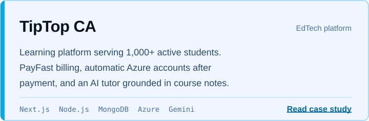
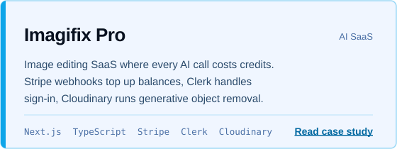
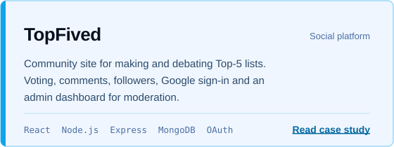
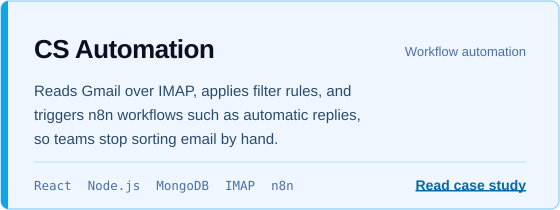
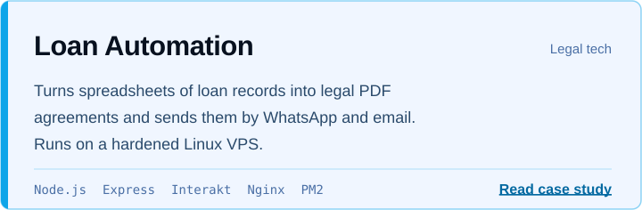
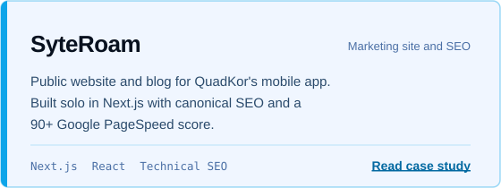

<picture><source media="(prefers-color-scheme: dark)" srcset="assets/banner-dark.svg"></picture>

I'm Wajid Ali, a full-stack developer (React, Next.js, Node.js) and the founder of [Devsiter](https://www.devsiter.com/), a web development agency. I build SaaS platforms, payment and billing systems, workflow automations and fast, SEO-ready websites for clients in the US, Canada and Europe, and I deploy and run them in production.

 

<picture><source media="(prefers-color-scheme: dark)" srcset="assets/stats-dark.svg"></picture>

## Selected client work

Client code is private, so each project below links to its full case study on [devsiter.com/work](https://www.devsiter.com/work), with screenshots, architecture and results.

<a href="https://www.devsiter.com/work/tiptopca"><picture><source media="(prefers-color-scheme: dark)" srcset="assets/card-tiptopca-dark.svg"></picture></a>

<a href="https://www.devsiter.com/work/imagifix-pro"><picture><source media="(prefers-color-scheme: dark)" srcset="assets/card-imagifix-pro-dark.svg"></picture></a>

<a href="https://www.devsiter.com/work/topfived"><picture><source media="(prefers-color-scheme: dark)" srcset="assets/card-topfived-dark.svg"></picture></a>

<a href="https://www.devsiter.com/work/cs-automation"><picture><source media="(prefers-color-scheme: dark)" srcset="assets/card-cs-automation-dark.svg"></picture></a>

<a href="https://www.devsiter.com/work/loan-automation"><picture><source media="(prefers-color-scheme: dark)" srcset="assets/card-loan-automation-dark.svg"></picture></a>

<a href="https://www.devsiter.com/work/syteroam"><picture><source media="(prefers-color-scheme: dark)" srcset="assets/card-syteroam-dark.svg"></picture></a>

Also built: [Premium Solutions](https://www.devsiter.com/work/premium-solutions), a Next.js storefront with an admin dashboard ([live](https://www.premiumsolutions.store/)), and [AssuredPosture](https://www.devsiter.com/work/assuredposture), a framework-free HTML and CSS site for a cybersecurity advisory firm.

## Stack

<picture><source media="(prefers-color-scheme: dark)" srcset="assets/skills-dark.svg"></picture>

## Work with me

I'm open to full-time full-stack roles, and I take fixed-price projects through Devsiter. I reply within 24 hours.

Email [wajid@devsiter.com](mailto:wajid@devsiter.com) · [LinkedIn](https://www.linkedin.com/in/wajid-ali-mern-developer) · [Upwork](https://www.upwork.com/freelancers/~0125146d71fac6995d) · [Devsiter on LinkedIn](https://www.linkedin.com/company/devsiter/)

Based in Karachi, Pakistan.
