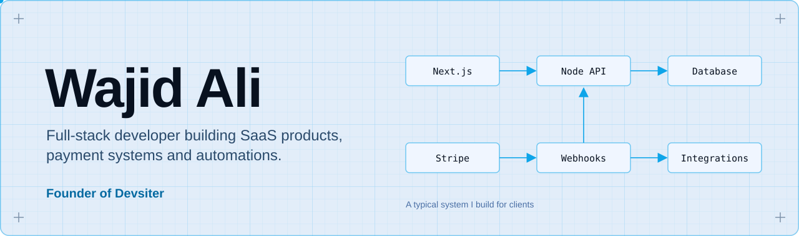
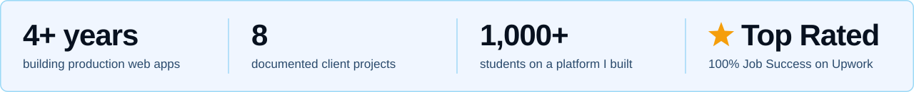
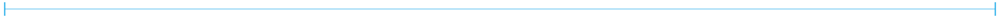
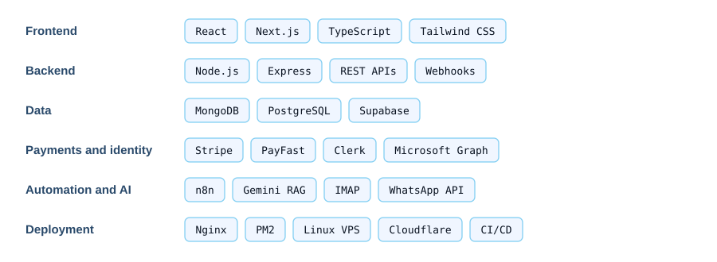

<picture><source media="(prefers-color-scheme: dark)" srcset="assets/banner-dark.svg"></picture>

I'm Wajid Ali, a full-stack developer (React, Next.js, Node.js) and the founder of [Devsiter](https://www.devsiter.com/), a web development agency. I build SaaS platforms, payment and billing systems, workflow automations and fast, SEO-ready websites for clients in the US, Canada and Europe, and I deploy and run them in production.

 

<picture><source media="(prefers-color-scheme: dark)" srcset="assets/stats-dark.svg"></picture>

## Selected client work

Client code is private, so each project below links to its full case study on [devsiter.com/work](https://www.devsiter.com/work), with screenshots, architecture and results.

<table>
<tr>
<td width="50%" valign="top">

<h3>TipTop CA</h3>

Learning platform for 1,000+ students with PayFast billing, automatic Azure accounts and an AI tutor grounded in course notes.

<code>Next.js</code> <code>Node.js</code> <code>MongoDB</code> <code>Azure</code> <code>Gemini</code>

<a href="https://www.devsiter.com/work/tiptopca">Case study</a> &nbsp;|&nbsp; <a href="https://tiptopca.co.za/">Live site</a>

 
</td>
<td width="50%" valign="top">

<h3>Imagifix Pro</h3>

Credit-metered AI image SaaS with Stripe webhooks, Clerk authentication and Cloudinary generative editing.

<code>Next.js</code> <code>TypeScript</code> <code>Stripe</code> <code>Clerk</code> <code>Cloudinary</code>

<a href="https://www.devsiter.com/work/imagifix-pro">Case study</a>

 
</td>
</tr>
<tr>
<td width="50%" valign="top">

<h3>TopFived</h3>

Social platform for Top-5 lists with voting, followers, Google sign-in and an admin moderation dashboard.

<code>React</code> <code>Node.js</code> <code>MongoDB</code> <code>OAuth</code>

<a href="https://www.devsiter.com/work/topfived">Case study</a>

 
</td>
<td width="50%" valign="top">

<h3>CS Automation</h3>

Gmail IMAP ingestion with a rule engine and n8n workflows that replace manual email triage.

<code>React</code> <code>Node.js</code> <code>MongoDB</code> <code>n8n</code>

<a href="https://www.devsiter.com/work/cs-automation">Case study</a>

 
</td>
</tr>
<tr>
<td width="50%" valign="top">

<h3>Loan Automation</h3>

Excel to legal PDF to WhatsApp and email pipeline for a legal practice, running on a hardened Linux VPS.

<code>Node.js</code> <code>Express</code> <code>Interakt</code> <code>Nginx</code> <code>PM2</code>

<a href="https://www.devsiter.com/work/loan-automation">Case study</a>

 
</td>
<td width="50%" valign="top">

<h3>SyteRoam</h3>

Marketing site and blog for QuadKor's mobile app, built solo with technical SEO and a 90+ PageSpeed score.

<code>Next.js</code> <code>React</code> <code>Technical SEO</code>

<a href="https://www.devsiter.com/work/syteroam">Case study</a> &nbsp;|&nbsp; <a href="https://syteroam.com/">Live site</a>

 
</td>
</tr>
</table>

Also built: [Premium Solutions](https://www.devsiter.com/work/premium-solutions), a Next.js storefront with an admin dashboard ([live](https://www.premiumsolutions.store/)), and [AssuredPosture](https://www.devsiter.com/work/assuredposture), a framework-free HTML and CSS site for a cybersecurity advisory firm.

## Stack

<picture><source media="(prefers-color-scheme: dark)" srcset="assets/skills-dark.svg"></picture>

## Work with me

I'm open to full-time full-stack roles, and I take fixed-price projects through Devsiter. I reply within 24 hours.

Email [wajid@devsiter.com](mailto:wajid@devsiter.com) · [LinkedIn](https://www.linkedin.com/in/wajid-ali-mern-developer) · [Upwork](https://www.upwork.com/freelancers/~0125146d71fac6995d) · [Devsiter on LinkedIn](https://www.linkedin.com/company/devsiter/)

Based in Karachi, Pakistan.
